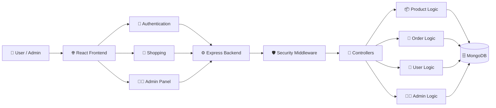
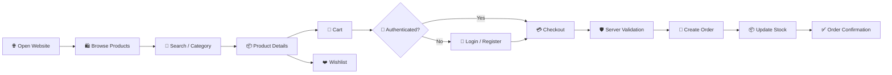
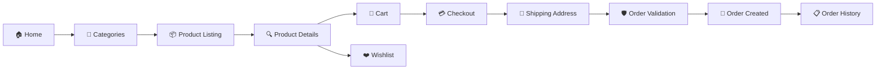
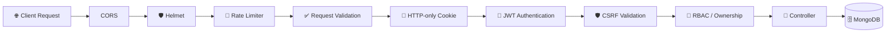
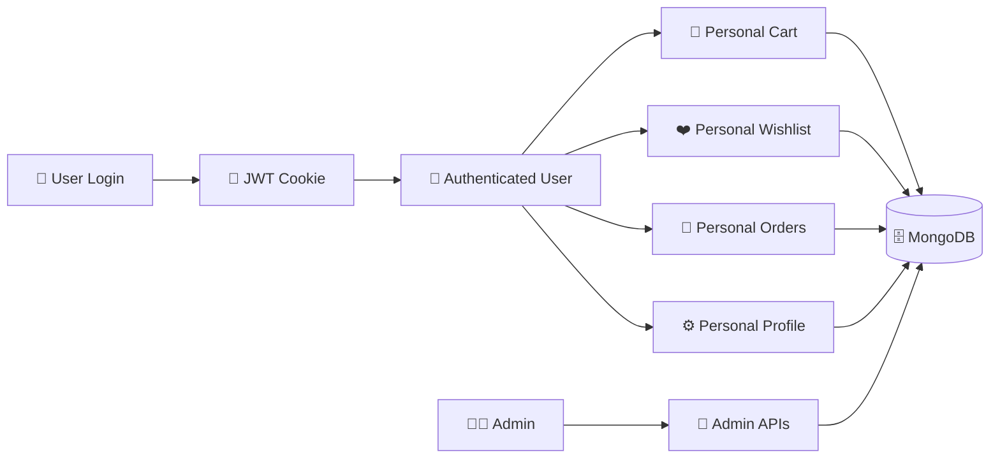
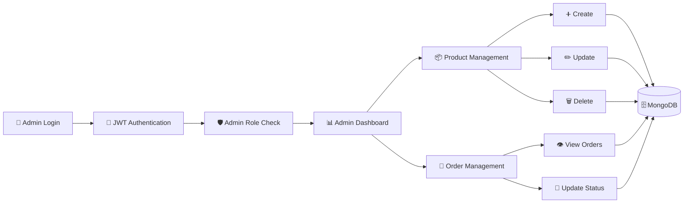
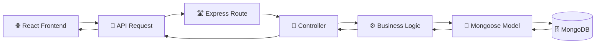
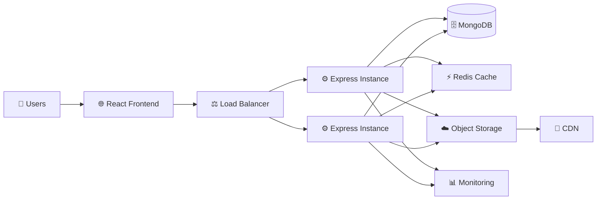

# 🛍️ NexoraCart

NexoraCart is a modern full-stack MERN e-commerce platform designed to provide a secure, responsive, and production-oriented online shopping experience.

It includes product discovery, search, category filtering, cart and wishlist management, secure checkout, order processing, customer account isolation, and role-based administration.

> **Shop smarter. Live better.**

---

## 🌐 Live Demo

🚀 **Live Application:** Coming Soon

🔗 **GitHub Repository:**  
https://github.com/ManjeetPrabhakarRawat/CodeAlpha_NexoraCart

---

# ✨ Features

## 🛒 Shopping

- Modern responsive e-commerce interface
- Product browsing by category
- Product search
- Product detail pages
- Shopping cart
- Wishlist
- Checkout
- Stock-aware shopping
- Discount and pricing display
- Responsive navigation
- Category-based product filtering
- No-results search state

## 📦 Product Management

- Create products
- Update products
- Delete products
- Product categories
- Product pricing
- Discount management
- Product ratings
- Review counts
- Stock management
- Featured products
- Product images
- Category filtering

## 🧾 Order Management

- Secure order creation
- Customer-specific order history
- Order details
- Shipping address
- Server-side price calculation
- Server-side stock validation
- Inventory updates
- Order status management
- Admin-controlled order processing

## 👤 User Accounts

- User registration
- Secure login
- Logout
- JWT authentication
- HTTP-only authentication cookies
- Profile management
- Account settings
- Customer-specific cart
- Customer-specific wishlist
- Customer-specific orders

## 👨‍💼 Admin

- Dedicated admin dashboard
- Product management
- Order management
- Order status updates
- Backend role-based access control
- Customer/admin separation
- Admin-only APIs
- Protected administrative operations

## 🔐 Security

- JWT authentication
- HTTP-only cookies
- bcrypt password hashing
- CSRF protection
- Role-based access control
- Customer ownership validation
- CORS allow-list
- Helmet security headers
- Rate limiting
- Request validation
- MongoDB ObjectId validation
- Server-side price validation
- Server-side stock validation
- Environment-based secrets
- Protected admin routes

---

# 🛠️ Technology Stack

## 🎨 Frontend

- React
- Vite
- JavaScript
- React Router
- Context API
- CSS

## ⚙️ Backend

- Node.js
- Express.js
- JavaScript
- JWT
- bcryptjs
- Helmet
- CORS
- express-rate-limit
- cookie-parser

## 🗄️ Database

- MongoDB
- Mongoose

---

# 🏗️ System Architecture



---

# 🔄 Application Workflow



---

# 🛒 Customer Shopping Architecture



---

# 📦 Order Processing Architecture

```mermaid
flowchart LR

    A[💳 Checkout Request] --> B[🔐 Authenticate User]

    B --> C[🛡️ Validate CSRF]

    C --> D[📦 Read Product Data]

    D --> E[💰 Validate Current Prices]

    E --> F[📊 Validate Stock]

    F --> G[🧮 Calculate Total]

    G --> H[🧾 Create Order]

    H --> I[📦 Update Inventory]

    I --> J[✅ Return Order]
```



---

# 🔐 Security Architecture



---

# 👤 Account Isolation Architecture



---

# 👨‍💼 Admin Architecture



---

# 🗄️ Database Architecture



---

# 📈 Scalable Architecture



---

# 📊 Product Catalog

NexoraCart contains **60 products** across 6 categories.

| Category | Products |
|---|---:|
| Electronics | 10 |
| Fashion | 10 |
| Home & Kitchen | 10 |
| Beauty & Personal Care | 10 |
| Sports & Fitness | 10 |
| Books & Stationery | 10 |
| **Total** | **60** |

---

# 📁 Project Structure

```text
NexoraCart/
│
├── backend/
│   │
│   ├── src/
│   │   ├── config/
│   │   │
│   │   ├── controllers/
│   │   │   ├── adminController.js
│   │   │   ├── authController.js
│   │   │   ├── orderController.js
│   │   │   └── productController.js
│   │   │
│   │   ├── middleware/
│   │   │   ├── auth.js
│   │   │   ├── error.js
│   │   │   └── security.js
│   │   │
│   │   ├── models/
│   │   │   ├── Order.js
│   │   │   ├── Product.js
│   │   │   └── User.js
│   │   │
│   │   ├── routes/
│   │   │   ├── admin.js
│   │   │   ├── auth.js
│   │   │   ├── orders.js
│   │   │   └── products.js
│   │   │
│   │   ├── utils/
│   │   │   ├── csrf.js
│   │   │   └── jwt.js
│   │   │
│   │   └── seed.js
│   │
│   ├── .env.example
│   ├── package.json
│   └── server.js
│
├── frontend/
│   │
│   ├── public/
│   │   └── favicon.svg
│   │
│   ├── src/
│   │   ├── components/
│   │   │   ├── Footer.jsx
│   │   │   ├── Header.jsx
│   │   │   └── ProductCard.jsx
│   │   │
│   │   ├── context/
│   │   │   └── AppContext.jsx
│   │   │
│   │   ├── pages/
│   │   │   ├── Admin.jsx
│   │   │   ├── Auth.jsx
│   │   │   ├── Cart.jsx
│   │   │   ├── Checkout.jsx
│   │   │   ├── Home.jsx
│   │   │   ├── OrderDetail.jsx
│   │   │   ├── Orders.jsx
│   │   │   ├── Product.jsx
│   │   │   └── SimplePages.jsx
│   │   │
│   │   ├── services/
│   │   │   └── api.js
│   │   │
│   │   ├── App.jsx
│   │   ├── main.jsx
│   │   └── styles.css
│   │
│   ├── .env.example
│   ├── index.html
│   ├── package.json
│   └── vite.config.js
│
├── .gitignore
└── README.md
```

---

# 🧩 Architecture Highlights

## 🔐 Authentication

Authentication is handled using JWT-based sessions with HTTP-only cookies.

The backend validates authenticated requests before allowing access to protected resources.

### Authentication Flow

```text
Register / Login
       │
       ▼
Password Verification
       │
       ▼
JWT Generation
       │
       ▼
HTTP-only Cookie
       │
       ▼
Authenticated Requests
       │
       ▼
Protected API
```

---

## 👤 Customer Data Isolation

Customer-owned resources are protected by backend ownership checks.

Each customer receives isolated:

- Cart
- Wishlist
- Orders
- Profile data

The frontend does not determine ownership. The backend validates the authenticated user before returning or modifying protected resources.

---

## 🛒 Cart & Wishlist

Cart and wishlist state is separated by authenticated customer.

```text
User Login
    │
    ▼
Authenticated User
    │
    ├──► Cart
    │
    └──► Wishlist
```

This prevents users from accidentally sharing cart or wishlist data between accounts.

---

## 💳 Checkout Security

Checkout calculations are performed on the backend.

The backend does not trust:

- Client-submitted prices
- Client-submitted totals
- Client-submitted stock values

Instead, current product data is retrieved from MongoDB before the order is created.

---

## 📦 Inventory Management

```text
Product
   │
   ▼
Current Stock
   │
   ▼
Checkout Validation
   │
   ▼
Stock Available?
   │
 ┌─┴─┐
 │   │
Yes  No
 │   │
 ▼   ▼
Order  Reject
 │
 ▼
Reduce Stock
```

---

# 🔌 API Areas

| API Area | Purpose |
|---|---|
| Authentication | Registration, login, logout and authentication |
| Products | Product discovery and product management |
| Orders | Order creation and order retrieval |
| Admin | Product and order administration |
| Health | API health verification |

---

# 🧪 Testing

The application has been tested for:

- Authentication
- Customer account isolation
- Cart isolation
- Wishlist isolation
- Order isolation
- Admin/customer separation
- Product management
- Order management
- Product search
- Category filtering
- Product details
- Checkout
- Stock handling
- Backend health endpoint
- Production frontend build
- Dependency audit

## ✅ Validation

### Backend

```text
✓ npm install
✓ 0 vulnerabilities
✓ MongoDB connection
✓ API health check
✓ Production server start
```

### Frontend

```text
✓ npm install
✓ npm audit
✓ Production build
✓ Vite build successful
```

---

# 📦 Local Setup

## ✅ Prerequisites

Make sure the following are installed:

- Node.js 18.18+
- npm
- Git
- MongoDB or MongoDB Atlas

---

# 🗄️ 1. Database Setup

NexoraCart uses MongoDB.

You can use either:

- Local MongoDB
- MongoDB Atlas

Create the backend `.env` file using `.env.example`.

```env
PORT=5000
NODE_ENV=development

MONGO_URI=your_mongodb_connection_string

JWT_SECRET=your_secure_random_jwt_secret

CLIENT_URL=http://localhost:5173

TRUST_PROXY=0

ADMIN_EMAIL=your_admin_email
ADMIN_PASSWORD=your_admin_password
```

> ⚠️ Never commit your real `.env` file or production secrets to GitHub.

---

# ⚙️ 2. Backend Setup

Open a terminal:

```bash
cd backend
npm install
```

Seed the database:

```bash
npm run seed
```

Start the development server:

```bash
npm run dev
```

Backend server:

```text
http://localhost:5000
```

API:

```text
http://localhost:5000/api
```

Health endpoint:

```text
http://localhost:5000/api/health
```

---

# 🎨 3. Frontend Setup

Open another terminal:

```bash
cd frontend
npm install
```

Create `.env`:

```env
VITE_API_URL=http://localhost:5000/api
```

Start the frontend:

```bash
npm run dev
```

Frontend:

```text
http://localhost:5173
```

---

# 🚀 4. Running the Application

Once both frontend and backend servers are running:

1. Open the frontend.
2. Register a customer account.
3. Login.
4. Browse products.
5. Search or select categories.
6. Add products to the cart.
7. Add products to the wishlist.
8. Proceed to checkout.
9. Enter shipping information.
10. Place the order.
11. Open the Orders section.
12. Admin can manage products and order status separately.

---

# 👑 Admin Access

Admin credentials are configured through environment variables:

```env
ADMIN_EMAIL=your_admin_email
ADMIN_PASSWORD=your_admin_password
```

Admin permissions are enforced by the backend.

Administrative operations cannot be granted simply by modifying frontend data.

---

# 🌍 Production Deployment

## Backend — Render

```text
Root Directory:
backend

Build Command:
npm install

Start Command:
npm start
```

Configure production environment variables:

```env
NODE_ENV=production
PORT=5000
MONGO_URI=your_mongodb_connection_string
JWT_SECRET=your_secure_random_jwt_secret
CLIENT_URL=your_frontend_url
TRUST_PROXY=1
ADMIN_EMAIL=your_admin_email
ADMIN_PASSWORD=your_admin_password
```

---

## Frontend — Render

```text
Root Directory:
frontend

Build Command:
npm install && npm run build

Publish Directory:
dist
```

Frontend environment variable:

```env
VITE_API_URL=your_backend_url/api
```

> Production secrets must be configured through the hosting provider and must never be committed to GitHub.

---

# 📈 Scalability

The application is structured so additional infrastructure can be introduced as traffic grows.

Potential improvements include:

- Redis caching
- Background jobs
- External object storage
- CDN integration
- Structured logging
- Monitoring
- API versioning
- Payment gateway integration
- Audit logging
- Database optimization
- Horizontal backend scaling

### Scalable Request Flow

```text
Users
  │
  ▼
React Frontend
  │
  ▼
Load Balancer
  │
  ├──────────────► Express Instance 1
  │
  └──────────────► Express Instance 2
                         │
                         ▼
                      MongoDB
```

---

# 📌 Project Status

| Component | Status |
|---|---|
| Frontend | ✅ Complete |
| Backend | ✅ Complete |
| Authentication | ✅ Complete |
| Products | ✅ Complete |
| Cart | ✅ Complete |
| Wishlist | ✅ Complete |
| Checkout | ✅ Complete |
| Orders | ✅ Complete |
| Admin | ✅ Complete |
| Security | ✅ Implemented |
| Account Isolation | ✅ Implemented |
| Local Testing | ✅ Passed |
| Production Build | ✅ Passed |
| Dependency Audit | ✅ Passed |

---

# 💡 Why NexoraCart?

NexoraCart combines the core functionality of a modern e-commerce platform into one full-stack application:

```text
🛍️ Product Discovery
        +
🔎 Search & Categories
        +
🛒 Cart & Wishlist
        +
💳 Secure Checkout
        +
🧾 Order Management
        +
👤 Customer Accounts
        +
👨‍💼 Admin Management
        +
🔐 Security
        ↓
🚀 NexoraCart
```

The project focuses not only on UI but also on backend security, customer data isolation, server-side validation, inventory management, and production-oriented architecture.

---

# 🧰 Built With

**React • Vite • JavaScript • Node.js • Express.js • MongoDB • Mongoose • JWT • bcryptjs • Helmet • CORS**

---

# 👨‍💻 Author

## Manjeet Prabhakar Rawat

Full-stack MERN developer focused on building secure, responsive, and production-oriented web applications.

### GitHub

https://github.com/ManjeetPrabhakarRawat

---

# ⭐ Support

If you find NexoraCart useful, consider giving the repository a ⭐ on GitHub.

---

<div align="center">

## 🛍️ NexoraCart

### Shop smarter. Live better.

</div>